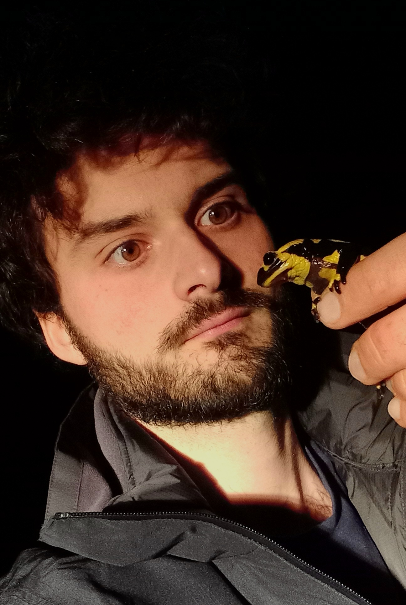
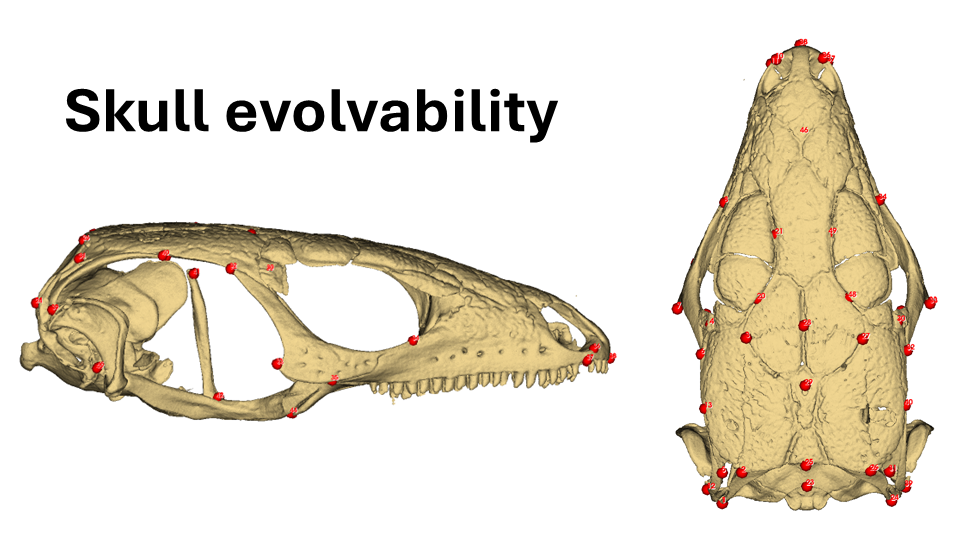
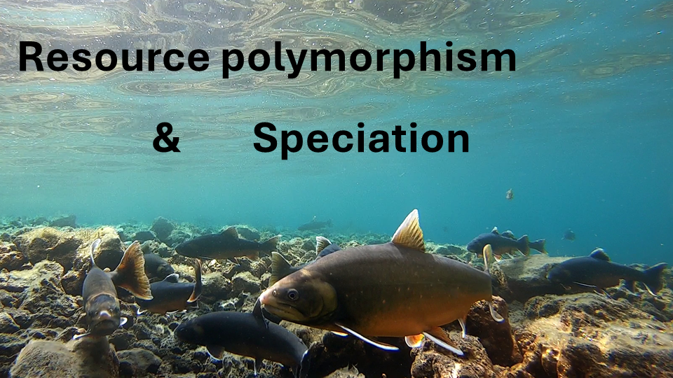

## Quentin HORTA-LACUEVA

::: column-page
{width="297" fig-align="center"}
:::

# 

#### Welcome to my website !

------------------------------------------------------------------------

My research is mainly focused of head shape evolution in vertebrate. I am currently based at the University of Oslo where I am conducting a project on beak evolution in crossbills.

My investigations involve genomics, morphological comparative studies and behavioural approaches.

Find more details on my main projects below.

# 

------------------------------------------------------------------------

# 

#### Navigate to my main projects:

**Adaptive divergence in crossbills (in progress)**

::: border

:::

# 

