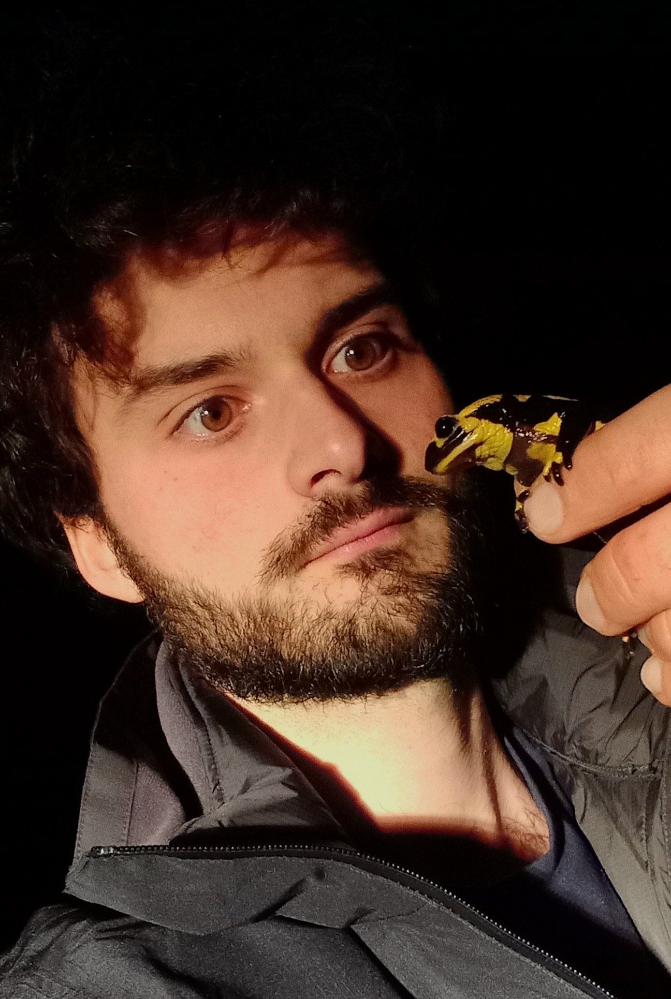
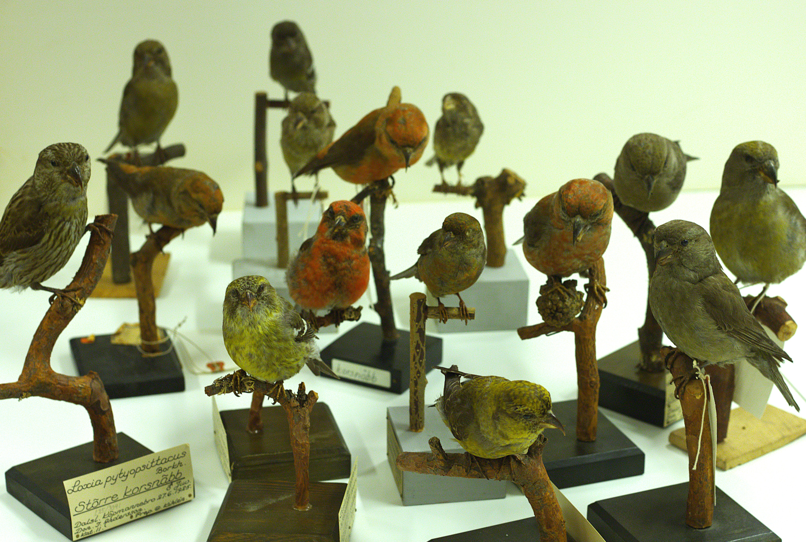
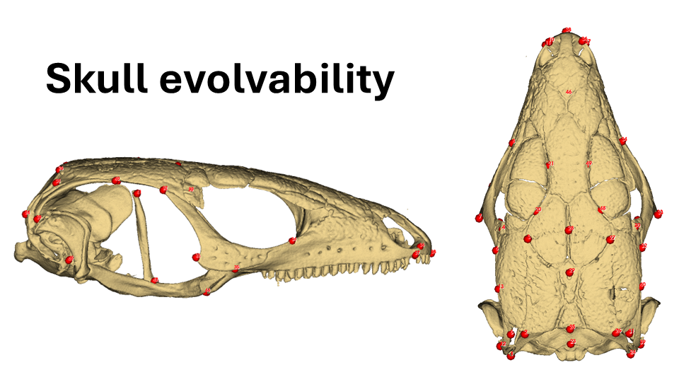
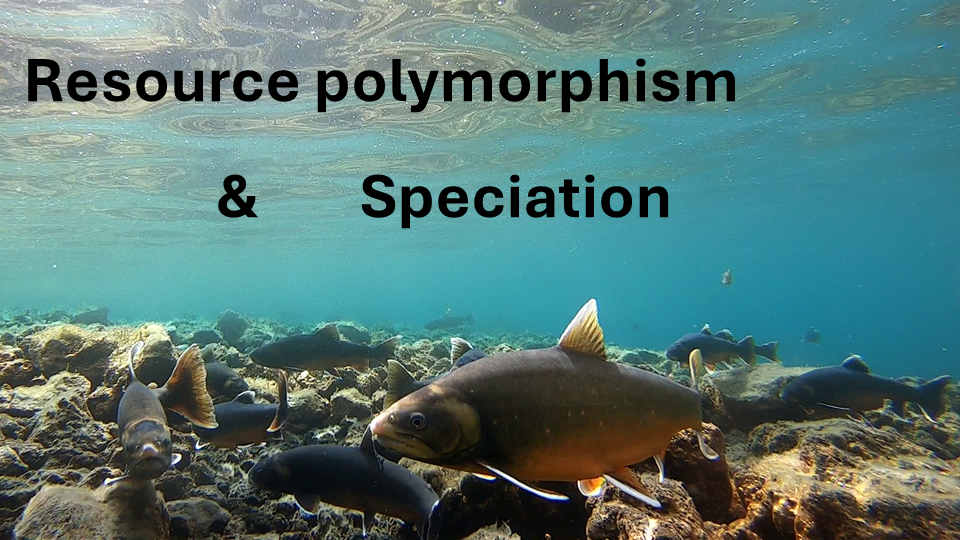

## Quentin HORTA-LACUEVA

:::::: columns
::: {.column width="35%"}
{width="297"}
:::

::: {.column width="5%"}
:::

::: {.column width="60%"}
#### Welcome to my page! {style="margin-top: 0;"}

My research is mainly focused on head shape evolution in vertebrates. I am currently based at the University of Oslo, where I am conducting a project on beak evolution in crossbills.

My field of expertise spans genomics, morphological comparative studies and behavioural approaches.

Find more details on my main projects below.
:::
::::::

------------------------------------------------------------------------

# 

#### Discover my projects

## **Adaptive divergence in crossbills (in progress)**

::: border

:::

# 

