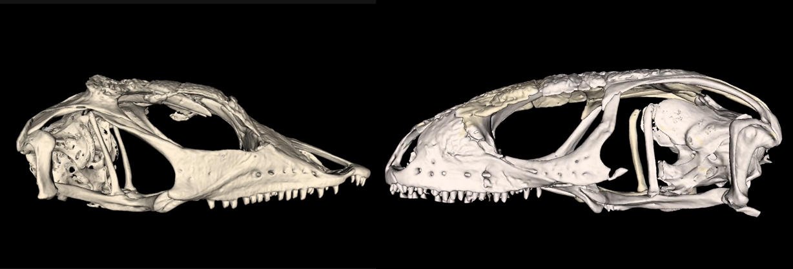

How adaptive changes occurring within populations (microevolution) generate diversity across the tree of life (macroevolution) is a classical yet unresolved issue in evolution. Development may bridge micro- and macroevolution by facilitating or constraining evolutionary changes over long evolutionary time scales.

Such contraints may originate from embryonic germ layers imposing distinct variational properties in different part of the same structure, like the skull in vertebrates.

I am exploring this topic by studying the skull of lacertids, an ecologicaly and morphologically diverse family of lizards. This work mainly consists of comparative studies based on X-ray microtomography data.

# 

# 

::: column-page

:::

# 

# 

**Reference**

**Horta-lacueva, Q.**, Müller, J., Uller, T., Flecks, M., Gabelaia, M., Hipsley, C.A., Kirchner, M., Müller, J., Feiner, N. (2025) Neural crest cell biology shapes lizard skull evolution across evolutionary time scales. *Evolution Letters*, 1–13.

# 

# 

This study is relared to a project on evolutionary symdromes conducted in the [Feiner-Uller research group](https://feiner-uller-group.se/).
